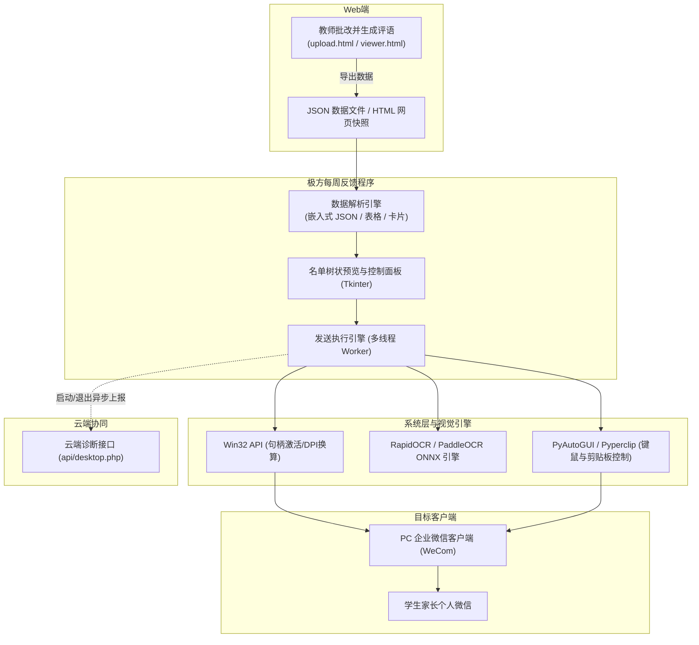
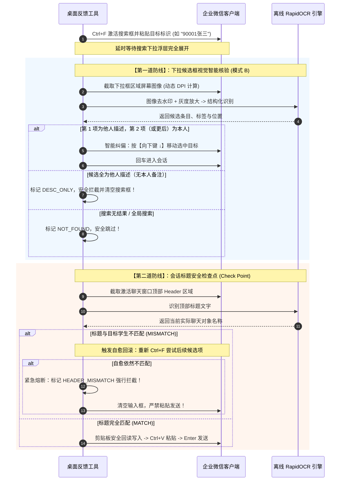

# 极方每周反馈程序 (Desktop Feedback Sender)

> **版本**：v1.3+  
> **定位**：教师端企业微信自动化专属反馈发送程序（Windows 独立桌面客户端）  
> **核心源码**：[`send_feedback.py`](send_feedback.py)  
> **打包配置**：[`send_feedback.spec`](send_feedback.spec) / [`.github/workflows/build-tools.yml`](../../.github/workflows/build-tools.yml)

---

## 目录

- [一、 业务背景与系统定位](#一-业务背景与系统定位)
- [二、 整体架构与数据流转](#二-整体架构与数据流转)
- [三、 核心技术原理与防误发体系](#三-核心技术原理与防误发体系)
  - [1. 模式 B 视觉智能核验 (第一道防线)](#1-模式-b-视觉智能核验-第一道防线)
  - [2. 会话标题安全检查点与自愈回滚 (第二道防线)](#2-会话标题安全检查点与自愈回滚-第二道防线)
  - [3. 图像预处理管线与水印擦除](#3-图像预处理管线与水印擦除)
  - [4. 高 DPI 感知与物理像素对齐](#4-高-dpi-感知与物理像素对齐)
- [四、 防风控与稳定性保障](#四-防风控与稳定性保障)
  - [1. 模拟真人操作与批次休眠](#1-模拟真人操作与批次休眠)
  - [2. 前台窗口失焦守护机制](#2-前台窗口失焦守护机制)
  - [3. 剪贴板竞态与安全核验](#3-剪贴板竞态与安全核验)
- [五、 数据管理与断点续发](#五-数据管理与断点续发)
- [六、 云端诊断与运维上报](#六-云端诊断与运维上报)
- [七、 编译构建与自动化发版](#七-编译构建与自动化发版)

---

## 一、 业务背景与系统定位

在作业反馈与错题巩固系统中，教师完成作业批改后，系统会为每位学生生成专属的个性化反馈文案与错题本落地页专属链接（`https://vip.wxjifang.cn/retest.html?token=...`）。

### 为什么采用客户端自动化？
1. **官方 API 约束**：企业微信应用机器人/第三方接口无法直接、不受限地向外部个人微信（学生家长）发起 1 对 1 私聊，且有严格的会话配额与认证门槛。
2. **零成本与高到达率**：借助教师 PC 端已登录的企业微信客户端会话上下文，模拟人工操作逐一发送，点对点触达家长，沟通自然且免除额外接口成本。

---

## 二、 整体架构与数据流转



### 数据载体解析策略
桌面程序支持两种数据载体：
1. **JSON 文件**：标准结构 `[{ "studentName": "90001张三", "message": "..." }]`。
2. **HTML 网页快照**：
   - **策略 1（高保真）**：优先提取 HTML 底部内嵌的 `<script type="application/json" id="feedback-data">`，实现结构化数据 100% 无损还原。
   - **策略 2（DOM 降级）**：解析 `<tr>` 表格中的 `.student-name` 与 `.feedback-content`。
   - **策略 3（卡片降级）**：兼容 Word 导出表格及 `.feedback-card` 布局。

---

## 三、 核心技术原理与防误发体系

家校沟通中，**“发错学生信息”是绝对不可接受的严重事故**。企微搜索输入姓名/学号时，常因群聊提及或备注描述，将“包含他人名字的联系人”排在第一位。

为彻底杜绝误发，程序构筑了**双重 OCR 闭环安全防护网**：



### 1. 模式 B 视觉智能核验 (第一道防线)
- **候选分类与判定**：`evaluate_contact_candidates()` 对 OCR 识别出的每一行进行深度判定：
  - 提取联系人备注、所属组织及灰色描述标签（“包含：...”）。
  - 若首项仅命中聊天记录或他人描述，而第 2 项命中本人学号/姓名，程序自动模拟按【向下键】纠正光标。
  - 若所有候选项均只包含描述而无目标本人备注，则触发 `DESC_ONLY` 强行拦截。

### 2. 会话标题安全检查点与自愈回滚 (第二道防线)
- **会话确认**：进入聊天窗口后，`verify_chat_header_title()` 截取顶部 Title 区域。
- **自愈纠偏**：若当前打开的会话不匹配（如因企微响应迟缓停留在上一人），自动唤起自愈流程：重新激活搜索，尝试按向下键选择第 2、第 3 个候选项并重新验证。
- **最终熔断**：三次自愈仍不符时，判定 `HEADER_MISMATCH`，立即清理输入框，绝不输入任何评语文字，并记录详细警告日志。

### 3. 图像预处理管线与水印擦除
企业微信窗口通常带有公司域倾斜半透明背景水印，直接识别易干扰 OCR 模型。
- `preprocess_dropdown_image()` 执行以下处理：
  1. 转为灰度图像，消除 ClearType 彩色边缘噪点。
  2. **水印消解**：将亮度值 `> 205` 的像素直接归一化为纯白底色（`255`），消除水印纹理。
  3. **双三次插值（BICUBIC）放大 2 倍**：提升 12px~14px 细小字体的笔画清晰度。

### 4. 高 DPI 感知与物理像素对齐
不同电脑显示器缩放设置（100%、125%、150%、200%）会导致坐标偏差。
- 启动时调用 Windows API `ctypes.windll.user32.SetProcessDpiAwarenessContext(-4)`（Per-Monitor DPI Aware V2）。
- 结合 `win32gui.GetWindowRect` 与 `get_display_scale()` 动态计算物理像素裁剪区域，保证在任意分辨率与多显示器环境下准确无误。

---

## 四、 防风控与稳定性保障

### 1. 模拟真人操作与批次休眠
为避免短时间内高频次自动化调用引起企业微信风控限制：
- **随机抖动延时**：单条之间配置随机浮动间隔（默认 2.0s ~ 5.0s）。
- **批次休息策略**：每连续发送 `batch_size` 人（默认 10 人），强制休眠 `batch_delay` 秒（默认 8.0s）。

### 2. 前台窗口失焦守护机制
- 发送循环中由 `is_foreground_wecom()` 实时巡检前台焦点窗口类名（`WeWorkWindow` / `WXWork`）。
- 一旦教师误点其他应用，或系统弹出弹窗夺走前台焦点，程序毫秒级暂停并告警，彻底避免向其它程序误输内容。

### 3. 剪贴板竞态与安全核验
- `safe_copy()` 写入剪贴板后立即循环回读校验内容，若不一致则多次重试，杜绝因系统剪贴板延迟导致把上一位学生的评语发送给下一位。

---

## 五、 数据管理与断点续发

- **本地存储路径**：数据持久化于用户文档目录 `%USERPROFILE%\Documents\JFFeedback\feedback_history.json`。
- **生命周期状态流转**：
  - `PENDING`：待发送
  - `SUCCESS`：发送成功
  - `NOT_FOUND`：通讯录中无此联系人
  - `DESC_ONLY`：仅有他人描述，智能拦截
  - `HEADER_MISMATCH`：会话标题核验不符，安全熔断
  - `UNCERTAIN_INTERCEPT`：会话身份存疑，安全拦截
  - `FAILED` / `ABORTED`：写入失败或手动中断
- **断点续发**：重复加载相同班级文件时，自动加载历史发送状态，支持“仅选中未发”与“一键重试失败项”。

---

## 六、 云端诊断与运维上报

程序包含单机诊断与远程协助链路：
- 启动与退出时，异步线程调用云端接口 [`api/desktop.php`](../../api/desktop.php)：
  - `action=upload_logs`：上报最近 300 行脱敏日志（含 OCR 决策过程、拦截原因）。
  - `action=upload_history`：上报发送历史快照。
- 管理员可在 Web 管理后台（`admin.html`）直接按 `module=desktop` 筛选查阅各校区教师的客户端运行状态。

---

## 七、 编译构建与自动化发版

本项目通过 GitHub Actions 实现 Windows 云端自动化打包，无需本地搭建复杂的 Windows 编译环境。

### 1. 触发构建
在本地打标签并推送：
```bash
git tag tools-v1.4
git push origin tools-v1.4
```

### 2. 云端流水线
工作流 [`.github/workflows/build-tools.yml`](../../.github/workflows/build-tools.yml) 将在 Windows Server 环境中自动执行：
1. 安装 Python 3.11 与锁定依赖（[`requirements.txt`](requirements.txt)）。
2. 使用 PyInstaller 与 [`send_feedback.spec`](send_feedback.spec) 完成单文件打包并注入图标。
3. 自动发布至 GitHub Releases，产物命名为 `极方每周反馈程序-v1.4.exe`。
