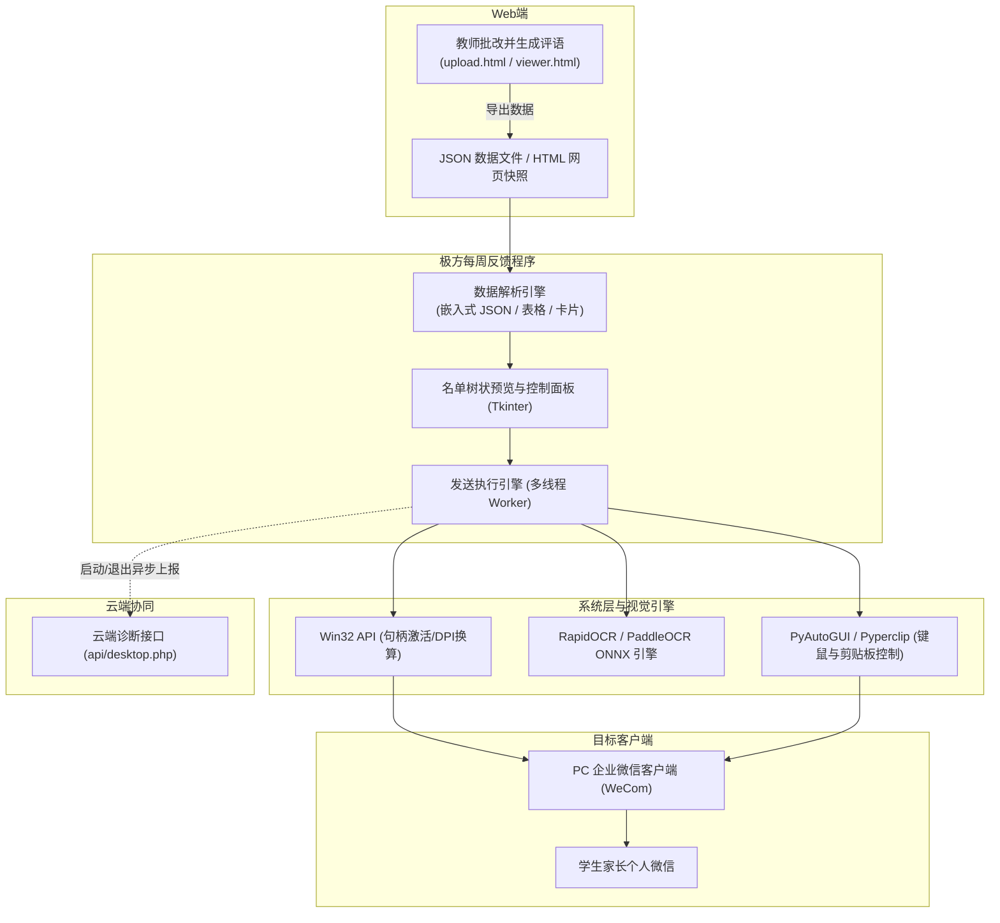
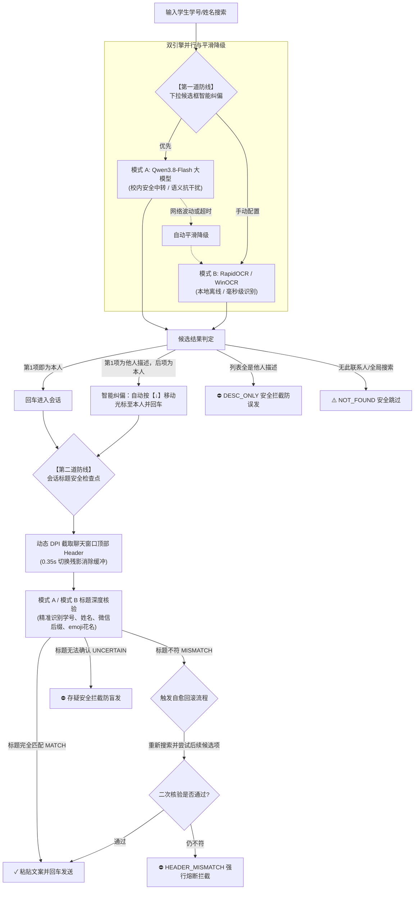
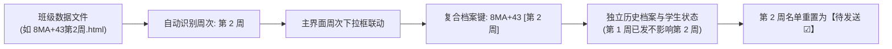
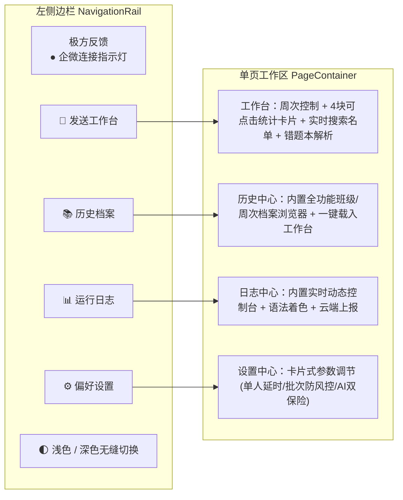

# 极方每周反馈程序 (Desktop Feedback Sender)

> **版本**：v1.6 / v1.6-fluent  
> **定位**：教师端企业微信自动化专属反馈发送程序（Windows 独立桌面客户端）  
> **平行双版本**：
> 1. **经典稳定版**：[`send_feedback.py`](send_feedback.py) / [`send_feedback.spec`](send_feedback.spec)
> 2. **Fluent 现代版**：[`send_feedback_fluent.py`](send_feedback_fluent.py) / [`send_feedback_fluent.spec`](send_feedback_fluent.spec)（基于 `sv-ttk`，支持深浅色无缝切换）  
> **云端流水线**：[`.github/workflows/build-tools.yml`](../../.github/workflows/build-tools.yml)

---

## 目录

- [一、 业务背景与系统定位](#一-业务背景与系统定位)
- [二、 整体架构与数据流转](#二-整体架构与数据流转)
- [三、 核心技术原理与防误发体系](#三-核心技术原理与防误发体系)
  - [1. AI 视觉双保险协同体系 (第一道防线)](#1-ai-视觉双保险协同体系-第一道防线)
  - [2. 会话标题安全检查点与自愈回滚 (第二道防线)](#2-会话标题安全检查点与自愈回滚-第二道防线)
  - [3. 图像预处理管线与水印消解](#3-图像预处理管线与水印消解)
  - [4. 高 DPI 感知与物理像素对齐](#4-高-dpi-感知与物理像素对齐)
- [四、 周次与周期分类管理架构](#四-周次与周期分类管理架构)
- [五、 防风控与稳定性保障](#五-防风控与稳定性保障)
  - [1. 模拟真人操作与批次休眠](#1-模拟真人操作与批次休眠)
  - [2. 前台窗口失焦守护机制](#2-前台窗口失焦守护机制)
  - [3. 剪贴板竞态与安全核验](#3-剪贴板竞态与安全核验)
- [六、 数据管理与断点续发](#六-数据管理与断点续发)
- [七、 云端诊断与运维上报](#七-云端诊断与运维上报)
- [八、 编译构建与自动化发版](#八-编译构建与自动化发版)
- [九、 Fluent 现代版全新交互架构 (Navigation Rail)](#九-fluent-现代版全新交互架构-navigation-rail)

---

## 一、 业务背景与系统定位

在作业反馈与错题巩固系统中，教师完成作业批改后，系统会为每位学生生成专属的个性化反馈文案与错题本落地页专属链接（`https://vip.wxjifang.cn/retest.html?token=...`）。

### 为什么采用客户端自动化？
1. **官方 API 约束**：企业微信应用机器人/第三方接口无法直接、不受限地向外部个人微信（学生家长）发起 1 对 1 私聊，且有严格的会话配额与认证门槛。
2. **零成本与高到达率**：借助教师 PC 端已登录的企业微信客户端会话上下文，模拟人工操作逐一发送，点对点触达家长，沟通自然且免除额外接口成本。

---

## 二、 整体架构与数据流转



### 数据载体解析策略
桌面程序支持两种数据载体：
1. **JSON 文件**：标准结构 `[{ "studentName": "90001张三", "message": "..." }]`。
2. **HTML 网页快照**：
   - **策略 1（高保真）**：优先提取 HTML 底部内嵌的 `<script type="application/json" id="feedback-data">`，实现结构化数据 100% 无损还原。
   - **策略 2（DOM 降级）**：解析 `<tr>` 表格中的 `.student-name` 与 `.feedback-content`。
   - **策略 3（卡片降级）**：兼容 Word 导出表格及 `.feedback-card` 布局。

---

## 三、 核心技术原理与防误发体系

家校沟通中，**“发错学生信息”是绝对不可接受的严重事故**。企微搜索输入姓名/学号时，常因群聊提及或备注描述，将“包含他人名字的联系人”排在第一位。

为彻底杜绝误发，程序设计了**模式 A / 模式 B 双引擎智能视觉防御体系**，并构筑了两道不可逾越的纵深闭环防护网：



### 1. AI 视觉双保险协同体系
- **云端大模型视觉感知 (通义千问 Qwen3.8-Flash，主力防线)**：
  - **超强语义抗干扰**：能敏锐分辨主联系人条目与次级“包含：90001”或“聊天记录：...”他人描述，无惧各种复杂昵称（如“🌺张三妈妈@微信”）、表情符号与群名混淆。
  - **架构安全中转**：客户端将局部截图通过 HTTPS 发送至校内中央服务器（`api/desktop.php?action=vision_detect`），由服务端集中调度阿里云百炼 DashScope 并校验，客户端代码及网络流量中完全不暴露大模型 API Key。
  - **超快响应**：调用参数关闭思考链（`enable_thinking: false`），单次判定耗时仅 300~600ms。
- **本地离线视觉引擎 (RapidOCR / WinOCR，后备保险)**：
  - **纯本地运行**：依托 ONNX 优化的 RapidOCR (PaddleOCR) 或 Windows 原生 WinOCR，无需外网访问，零云端 API 成本。
  - **毫秒级推断**：单张切片 OCR 识别仅需 50~150ms。
- **无感平滑双保险 (Auto Fallback)**：
  - 程序默认全自动运行双保险体系。当云端 API 因网络波动或校园防火墙偶发受阻时，客户端毫秒级自动回退至本地 OCR 引擎继续执行，保障批量发送流水线绝不中断，教师无需任何多余设置。

### 2. 第一道防线：下拉候选框智能纠偏
- 输入学生学号/姓名后，等待下拉候选列表呈现，自适应截取下拉区域（约 380x460 物理像素）。
- 视觉引擎对候选项列表执行结构化裁决：
  - **情况 1 (choice = 1)**：第 1 项即为本人独立联系人，直接两次回车进入会话。
  - **情况 2 (choice >= 2)**：第 1 项为他人描述（如提及了该学号的聊天记录），本人条目排在第 choice 项。程序自动模拟按 `(choice - 1)` 次【向下键 ↓】纠偏光标后回车进入。
  - **情况 3 (choice = -2 / DESC_ONLY)**：搜索结果全为他人描述或聊天记录，通讯录中不存在独立本人备注，自动清空搜索框并拦截防误发。
  - **情况 4 (choice = 0 / NOT_FOUND)**：无此联系人（显示网络查找或全局搜索），自动安全跳过并记录。

### 3. 第二道防线：会话标题安全检查点与自愈回滚
- **0.35s 切换残影消除**：企微从前一个聊天切换到新聊天时，顶部标题存在几百毫秒的淡入动画与残影。程序预留 0.35s 动画缓冲后再取景，确保截取的画面属于当前新会话。
- **标题深度核实**：截取右侧聊天区域顶部 Header 标题栏（约 400x52 物理像素），深度校验标题是否包含目标学号或目标姓名。
- **自愈纠错与多轮重试**：若标题不符（如误入其他学生或同事聊天），程序绝不输入任何内容，立即拉响警报并触发自愈回滚：重新唤起搜索，尝试按【↓】进入第 2、第 3 项重新比对标题。
- **强行熔断拦截**：若自愈依然不匹配，判定为 `HEADER_MISMATCH`，彻底终止对该学生的发送并清空输入框，100% 杜绝发错人。

### 4. 图像预处理管线与水印消解
企业微信窗口带有公司域半透明倾斜背景水印，本地预处理管线执行：
1. 转为灰度图像，消除 ClearType 边缘噪点。
2. **水印消解**：将亮度值 `> 205` 的像素归一化为纯白底色（`255`），擦除倾斜水印文字。
3. **双三次插值（BICUBIC）放大 2 倍**：提升 12px~14px 细小字体的笔画边缘锐利度。

### 5. 高 DPI 感知与物理像素对齐
不同电脑显示器缩放设置（100%、125%、150%、200%）会导致坐标偏差。
- 启动时调用 Windows API `ctypes.windll.user32.SetProcessDpiAwarenessContext(-4)`（Per-Monitor DPI Aware V2）。
- 结合 `win32gui.GetWindowRect` 与 `get_display_scale()` 动态计算物理像素裁剪区域，保证在任意分辨率与多显示器环境下准确无误。

---

## 四、 周次与周期分类管理架构

实际教学工作中，教师通常每周针对同一班级发送一次反馈。如果历史记录仅按班级名记录，第二周发送时系统会误以为“所有学生均已发送过”而无法直接勾选发送。

为了解决周期性发送冲突，v1.6 引入了**周次/周期分类管理体系**：



1. **界面周次快速选择**：主界面直观提供周次下拉选择器（预设 `第 1 周` ~ `第 24 周`，支持用户任意手动自定义）。
2. **智能文件名识别**：载入文件时，自动正则扫描文件名提取周次（支持 `第X周`、`W02`、`Week 3`、`第一周` 等），自动切换主界面当前周次。
3. **复合归档键与数据隔离**：底层历史记录采用 `班级名 [周次]` 独立归档，不同周次互不干扰。无论文件名是否变化，只需切换周次，新周次的学生名单自动就绪为 `待发送`。
4. **历史中心周次过滤与导出**：历史记录管理中心新增周次过滤下拉框，班级列表展示周次；导出 CSV 报表新增“周次”列，方便学校教务统一按周汇总。
5. **历史数据 100% 平滑兼容**：自动兼容旧版未带周次的单班级历史记录，平滑迁移至“第 1 周”，历史数据绝不丢失。

---

## 五、 防风控与稳定性保障

### 1. 模拟真人操作与批次休眠
为避免短时间内高频次自动化调用引起企业微信风控限制：
- **随机抖动延时**：单条之间配置随机浮动间隔（默认 2.0s ~ 5.0s）。
- **批次休息策略**：每连续发送 `batch_size` 人（默认 10 人），强制休眠 `batch_delay` 秒（默认 8.0s）。

### 2. 前台窗口失焦守护机制
- 发送循环中由 `is_foreground_wecom()` 实时巡检前台焦点窗口类名（`WeWorkWindow` / `WXWork`）。
- 一旦教师误点其他应用，或系统弹出弹窗夺走前台焦点，程序毫秒级暂停并告警，彻底避免向其它程序误输内容。

### 3. 剪贴板竞态与安全核验
- `safe_copy()` 写入剪贴板后立即循环回读校验内容，若不一致则多次重试，杜绝因系统剪贴板延迟导致把上一位学生的评语发送给下一位。

---

## 六、 数据管理与断点续发

- **本地存储路径**：数据持久化于用户文档目录 `%USERPROFILE%\Documents\JFFeedback\feedback_history.json`。
- **生命周期状态流转**：
  - `PENDING`：待发送
  - `SUCCESS`：发送成功
  - `NOT_FOUND`：通讯录中无此联系人
  - `DESC_ONLY`：仅有他人描述，智能拦截
  - `HEADER_MISMATCH`：会话标题核验不符，安全熔断
  - `UNCERTAIN_INTERCEPT`：会话身份存疑，安全拦截
  - `FAILED` / `ABORTED`：写入失败或手动中断
- **断点续发**：同周次重新载入文件时，自动恢复该周次的发送进度；切换至新周次时，自动重置为未发送。

---

## 七、 云端诊断与运维上报

程序包含单机诊断与远程协助链路：
- 启动与退出时，异步线程调用云端接口 [`api/desktop.php`](../../api/desktop.php)：
  - `action=upload_logs`：上报最近 300 行脱敏日志（含 AI 视觉决策过程、拦截原因）。
  - `action=upload_history`：上报发送历史快照。
- 管理员可在 Web 管理后台（`admin.html`）直接按 `module=desktop` 筛选查阅各校区教师的客户端运行状态。

---

## 八、 编译构建与自动化发版

本项目通过 GitHub Actions 实现 Windows 云端自动化打包，无需本地搭建复杂的 Windows 编译环境。

### 1. 触发构建
在本地打标签并推送：
```bash
git tag tools-v2.0
git push origin tools-v2.0
```

### 2. 反误报打包策略（重要）

桌面端曾长期被杀毒软件误报。排查后确认：**问题不在 Python 语言，而在打包方式与产物体征**。
已于 v2.0 起完成下列整改（改动集中在两个 `.spec` 与 `build-tools.yml`，**业务代码零改动**）：

| # | 措施 | 解决的问题 |
|---|---|---|
| 1 | `upx=False` + `--noupx` | UPX 段头（UPX0/UPX1/UPX2）是杀软最典型的识别特征，加壳几乎必被静态引擎命中 |
| 2 | onefile → **onedir + zip 分发** | onefile 启动时把 90MB 自解压到 `%TEMP%\_MEIxxxxx` 并派生子进程，这套行为是启发式引擎的重点监控对象 |
| 3 | 移除 **opencv-python** | 曾锁定 `5.0.0.93`，但全项目 `grep cv2` **零命中**，纯无用负担，且其原生扩展是把产物撑到 91MB、熵值拉高的主因 |
| 4 | spec `EXCLUDES` 清单 | 剔除 `scipy`/`sklearn`/`matplotlib`/`pandas` 等 OCR 传递依赖的非必要分支，避免打包出杀软高度警惕的原生扩展矩阵 |
| 5 | `version_info.txt` 版本资源块 | 写入明确的中文厂商/产品/版本信息（资源管理器「属性→详细信息」可见），避免因「未知来源 + 无版本信息」落入通用规则 |
| 6 | 补打包 `favicon.ico` | 此前打包态下图标资源缺失，`get_resource_path()` 找不到后退回系统默认图标（异常被 `except: pass` 静默吞掉），现已修复 |
| 7 | **可选代码签名** | 见下方第 3 节 |

整改后预期产物：**91.5 MB → 约 40 MB 量级**，且不再具备自解压 / 加壳 / 无标识三大特征。

> **仍需注意**：程序本身包含截屏、键鼠注入、剪贴板读写、向服务端上传截图切片等行为，
> 这些特征与语言无关，任何语言实现都会命中行为型引擎。若仍被拦截，
> 请将**整个解压后的文件夹**（而非单个 exe）加入白名单，并优先配置代码签名。

### 3. 代码签名（可选，压制误报最彻底的一招）

无签名程序的信誉分从发布第一天就是 0，因此签名收益最大。**启用无需改动工作流文件**，
在 GitHub 仓库配置即可：

- `Settings` → `Secrets and variables` → `Actions`
  - **Variables** 标签页：新增 `WIN_CERT_NAME` = 证书主体名（如 `极方教育`）
  - **Secrets** 标签页：新增
    - `WIN_CERT_PFX` = **base64 编码**后的 `.pfx` 证书（注意是 base64 文本，不是二进制文件）
    - `WIN_CERT_PASSWORD` = pfx 解锁口令

未设置 `WIN_CERT_NAME` 时签名步骤自动跳过，不影响构建。签名后 exe 的发布者信誉会随
下载量与使用时长累积，误报率随之显著下降。

### 4. 产物与安装方式

工作流 [`.github/workflows/build-tools.yml`](../../.github/workflows/build-tools.yml) 在 Windows runner 上：

1. 安装 Python 3.14 与锁定依赖（`requirements.txt`，已移除 opencv-python）。
2. 依次执行 `pyinstaller --noupx send_feedback.spec` 与 `send_feedback_fluent.spec`，产出两个目录式文件夹。
3. （可选）Authenticode 签名并 `signtool verify` 校验。
4. 用 Python `zipfile` 打包为 Release 附件（选用 `zipfile` 而非外部压缩工具，
   是为保证中文文件名正确置位 UTF-8 标志位，Windows 资源管理器解压不会乱码）：

   - `极方每周反馈程序-${VER}.zip`（经典稳定版）
   - `极方每周反馈程序-Fluent版-${VER}.zip`（Fluent 现代版）

**教师端安装**：下载 zip → **完整解压**到任意文件夹 → 双击文件夹内的同名 exe。

> 请勿在压缩包内直接运行，也请勿把 exe 单独拖出来。onedir 产物依赖同目录的配套运行库，
> 单独取走 exe 会启动失败。

---

## 九、 Fluent 现代版全新交互架构 (Navigation Rail)

重构后的 Fluent 现代版（[`send_feedback_fluent.py`](send_feedback_fluent.py)）突破了传统 Tkinter 的单一窗体限制，采用 **Windows 11 Fluent 2.0 原生设计范式**，带来颠覆性的全新桌面交互：



### 1. 核心交互升级特性

1. **左侧 Navigation Rail (侧边导航栏)**：
   - 告别经典版的全局二级弹窗！所有功能（工作台、历史档案、运行日志、偏好设置）统一在主窗口内**多视图无缝平滑切换**。
   - 实时企微状态指示灯：`● 企微已连接` / `○ 企微未运行`，无需盲猜企微窗口是否有效就位。
   - 快捷键深度适配：`Ctrl+1` 工作台、`Ctrl+2` 历史、`Ctrl+3` 日志、`Ctrl+4` / `Ctrl+,` 偏好设置。

2. **数据指标统计卡片 (Metric Cards) 与一键过滤交互**：
   - 工作台顶部横排 4 块现代卡片：`👥 总名单`、`⏳ 待发送`、`✅ 已发送`、`⚠️ 异常/拦截`。
   - **交互创新**：卡片兼具过滤器功能！点击“待发送”卡片直接过滤待发名单，点击“异常”卡片直接查看拦截或失败名单，操作一触即达。

3. **即时名单搜索 (Instant Search & Filter Bar)**：
   - 名单上方提供实时搜索框，输入学生姓名或学号毫秒级实时过滤名单树。
   - 状态筛选胶囊按钮（全部/待发/已发/异常）与批量快速操作按钮。

4. **学员个性化卡片与专属错题本解析 (Retest Link Card)**：
   - 右侧不仅高亮呈现个性化评语与字数统计，更具备**智能 URL 解析引擎**：
   - 自动提取文案中的专属错题本链接（`retest.html?token=...`），自动展示错题本操作面板：
     - `🔗 复制错题本链接`：一键复制纯链接。
     - `🌐 浏览器打开`：直接在系统浏览器中快速预览学生的专属错题练习。

5. **内置历史档案中心 (Embedded History)**：
   - 历史记录直接内置于应用中（按周次筛选、班级搜索、学员明细）。
   - 提供 **“🚀 载入到工作台直接发送”**，一键将历史档案或重考班级直接无缝载入工作台并就位，免去手动反复找文件的繁琐流程。

6. **透明卡片式设置中心 (Settings)**：
   - 告别经典版捉迷藏式的“连击标题3次”。
   - 提供标准的现代设置中心，直观配置单人延时、批次防风控休眠、AI 视觉双保险模式及参数保存。
