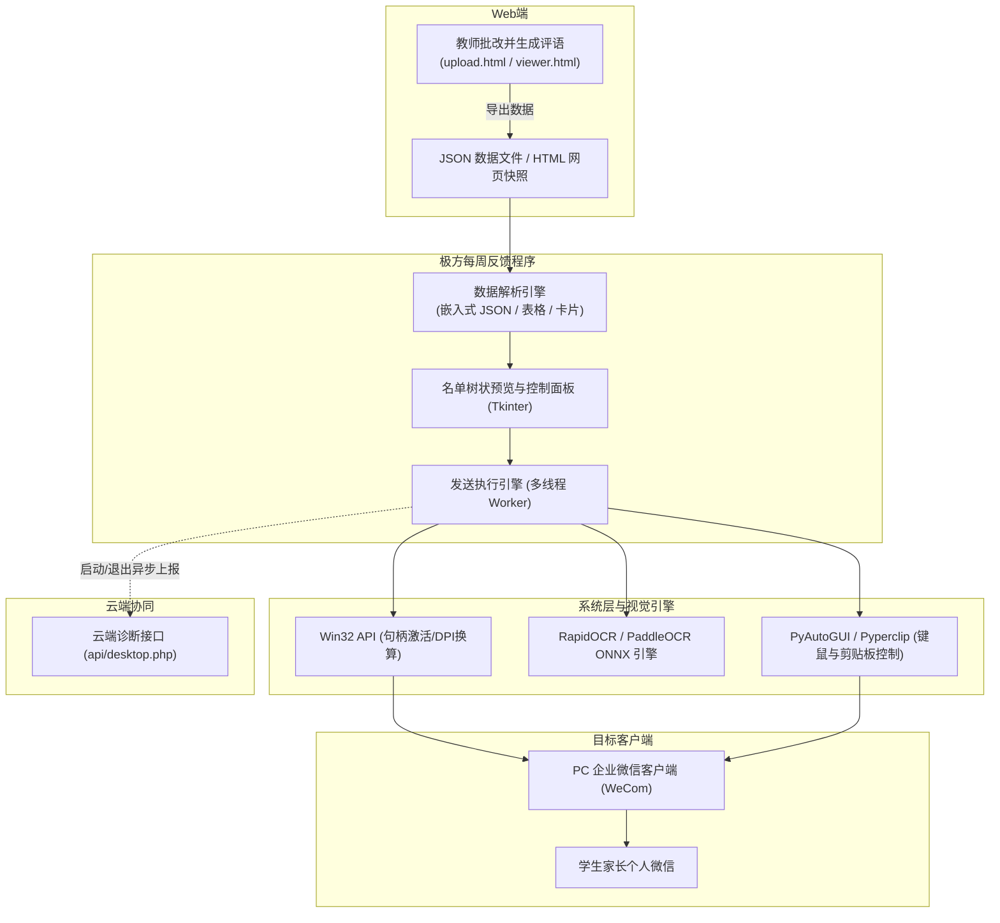
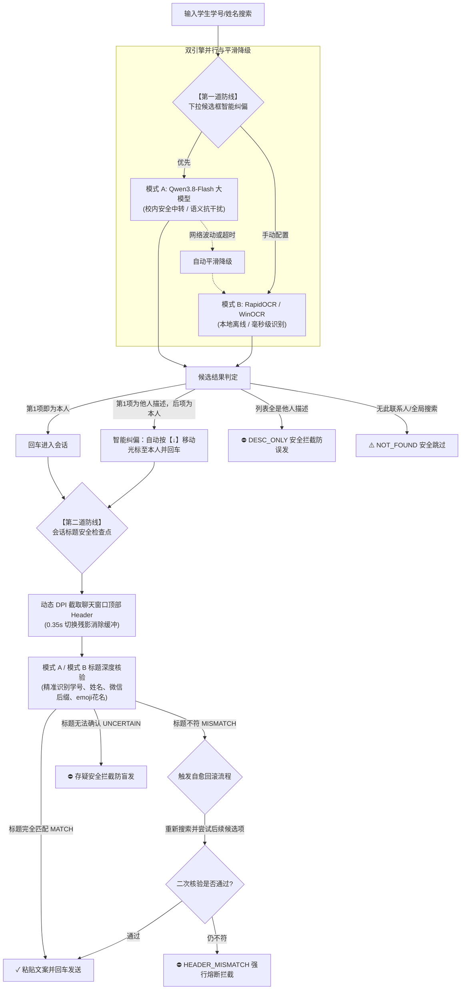
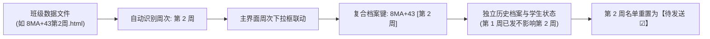

# 极方每周反馈程序 (Desktop Feedback Sender)

> **版本**：v2.0 经典稳定版  
> **定位**：教师端企业微信自动化专属反馈发送程序（Windows 独立桌面客户端）  
> **代码实现**：[`send_feedback.py`](send_feedback.py) / 打包规范：[`send_feedback.spec`](send_feedback.spec)  
> **云端流水线**：[`.github/workflows/build-tools.yml`](../../.github/workflows/build-tools.yml)  
> *注：新一代 Fluent 现代多视图交互已由独立工程 [`../desktop-sender-rs/`](../desktop-sender-rs/) (Rust + Tauri 2.0) 正式接管。*

---

## 目录

- [一、 业务背景与系统定位](#一-业务背景与系统定位)
- [二、 整体架构与数据流转](#二-整体架构与数据流转)
- [三、 核心技术原理与防误发体系](#三-核心技术原理与防误发体系)
  - [1. 架构安全中转：视觉判定全部走校内服务器](#1-架构安全中转视觉判定全部走校内服务器)
  - [2. 候选遍历：机械顺序 1→2→3，不再询问模型选人](#2-候选遍历机械顺序-123不再询问模型选人)
  - [3. 唯一放行闸门：整窗会话判定（WGC 抓帧 + 一次调用四合一）](#3-唯一放行闸门整窗会话判定wgc-抓帧--一次调用四合一)
  - [4. 抓帧稳定性与已知局限（必须知情）](#4-抓帧稳定性与已知局限必须知情)
  - [5. 待回消息名单](#5-待回消息名单-v260-新增)
  - [6. 图像预处理管线与水印消解](#6-图像预处理管线与水印消解)
  - [7. 高 DPI 感知与物理像素对齐](#7-高-dpi-感知与物理像素对齐)
- [四、 周次与周期分类管理架构](#四-周次与周期分类管理架构)
- [五、 防风控与稳定性保障](#五-防风控与稳定性保障)
  - [1. 模拟真人操作与批次休眠](#1-模拟真人操作与批次休眠)
  - [2. 前台窗口失焦守护机制](#2-前台窗口失焦守护机制)
  - [3. 剪贴板竞态与安全核验](#3-剪贴板竞态与安全核验)
- [六、 数据管理与断点续发](#六-数据管理与断点续发)
- [七、 云端诊断与运维上报](#七-云端诊断与运维上报)
- [八、 编译构建与自动化发版](#八-编译构建与自动化发版)
- [九、 事故举证与复盘](#九-事故举证与复盘)

---

## 一、 业务背景与系统定位

在作业反馈与错题巩固系统中，教师完成作业批改后，系统会为每位学生生成专属的个性化反馈文案与错题本落地页专属链接（`https://vip.wxjifang.cn/retest.html?token=...`）。

### 为什么采用客户端自动化？
1. **官方 API 约束**：企业微信应用机器人/第三方接口无法直接、不受限地向外部个人微信（学生家长）发起 1 对 1 私聊，且有严格的会话配额与认证门槛。
2. **零成本与高到达率**：借助教师 PC 端已登录的企业微信客户端会话上下文，模拟人工操作逐一发送，点对点触达家长，沟通自然且免除额外接口成本。

---

## 二、 整体架构与数据流转



### 数据载体解析策略
桌面程序支持两种数据载体：
1. **JSON 文件**：标准结构 `[{ "studentName": "90001张三", "message": "..." }]`。
2. **HTML 网页快照**：
   - **策略 1（高保真）**：优先提取 HTML 底部内嵌的 `<script type="application/json" id="feedback-data">`，实现结构化数据 100% 无损还原。
   - **策略 2（DOM 降级）**：解析 `<tr>` 表格中的 `.student-name` 与 `.feedback-content`。
   - **策略 3（卡片降级）**：兼容 Word 导出表格及 `.feedback-card` 布局。

---

## 三、 核心技术原理与防误发体系

家校沟通中，**“发错学生信息”是绝对不可接受的严重事故**。企微搜索输入姓名/学号时，常因群聊提及或备注描述，将“包含他人名字的联系人”排在第一位。

为彻底杜绝误发，程序设计了**模式 A / 模式 B 双引擎智能视觉防御体系**，并构筑了两道不可逾越的纵深闭环防护网：



### 1. 架构安全中转：视觉判定全部走校内服务器
客户端**不含任何大模型 API Key**，也不直连云厂商。局部/整窗截图经 HTTPS 发至校内中央服务器（`api/desktop.php?action=vision_detect`），由服务端集中调度阿里云百炼 DashScope 并校验。调用参数关闭思考链（`enable_thinking: false`），单次判定耗时 300~600ms。

### 2. 候选遍历：机械顺序 1→2→3，不再询问模型选人
- 输入「学号+姓名」后等待下拉列表呈现，**按第 1 → 2 → 3 项顺序逐个试探**，最多 3 个，绝不无限循环。
- **v2.6.0 起下拉截图整步删除**。下拉截图唯一的产出是 `choice`（指一个起始项），而身份认定权本来就在标题闸门；删掉后常见情况（输全「学号+姓名」，目标通常就在第 1 项）从 2 次 API 调用降到 **1 次**。
- 代价：目标不在第 1 项时必须按 3 次回车、进 3 个会话。而**进会话这一步本身就会清掉该家长会话的未读角标**（不是发消息那一步），所以待回留痕必须覆盖每一个进入过的候选（见第 5 节）。
- 旧版的「下拉里确实没有本人条目 → 判定查无此人并跳过」已随下拉截图一起删除。本地判据是纯字符串比对，无法区分联系人与群；根治改由整窗图里的 `is_group`（见下节）。

### 3. 唯一放行闸门：整窗会话判定（WGC 抓帧 + 一次调用四合一）
按回车后执行一次云端视觉调用，**同时**裁决四件事：

| 字段 | 含义 | 判定方向 |
|---|---|---|
| `detected_title` / `title_in_header` | 顶部标题栏读到的会话名 / 是否真读到了标题栏 | **fail-closed**：读不到 = 拦截 |
| `is_group` | 是否群聊（标题栏成员数 / 头像拼图 / 群系统提示） | **fail-closed**：是群一律拦截 |
| `matched` | 会话名是否**同时**含目标学号与目标姓名 | **fail-closed**：缺一即拦 |
| `last_sender` / `last_message_text` / `needs_reply` | 最后一条消息的发送方与原文、以及是否需要回复 | **fail-open**：判不出 = 标「待人工确认」，**照发不误** |

两个方向**相反且不可写反**：身份判不出就绝不发（少发一条可补，误发一条是事故）；待回判不出就照发（宁可让老师多回一条消息）。

- **抓帧用 Windows Graphics Capture (WGC) 优先，PyAutoGUI 兜底。** WGC 直接向合成器索取窗口表面，与屏幕位置、被谁遮挡完全无关。选它的实证依据见 `probe_out/`：企微窗口摆在 y=1212、约 77% 悬在屏幕下边缘外时，PyAutoGUI 截出的第 7~29 行是纯黑（亮度 0）；遮挡场景同理。WGC 命中时完全不需要收起本程序自己的窗口（只有两条 PyAutoGUI 兜底路径还需要）。
- **等画面稳定**：企微渐进渲染（标题栏先出、消息气泡后出），且真机已实证 WGC 在拿不到新表面时**返回缓存旧帧而不报错**（`wgc-minimized.png` 与 `wgc-visible.png` 的 md5 完全相同）。故连拍两帧（间隔 0.3s）逐像素比对，一致才采信，上限 1.5s。
- **三道本地防线**（模型判错时的兜底，缺一不可）：
  1. `is_group` 为真 → 直接 `MISMATCH`。根治了旧版的群聊误发洞 —— 标题「`90001张三家长群`」同时含学号和姓名，纯字符串比对会判 `MATCH` 并把反馈发进 100 人群。
  2. `detected_title` 长度 > 15 → `MISMATCH`。整窗图里还有聊天区，模型一旦把聊天正文当成标题塞进来，长度必然远超这个量级。旧版靠「只截窄标题条」来结构性保证图里只有标题，整窗方案必须补这道长度防线。
  3. `title_in_header` 缺失**绝不默认 `True`**（那等于放弃这道防线）：缺字段一律按「没读到标题栏」处理 → `UNCERTAIN` → 拦截。
- **自愈与熔断**：身份不符 → 立刻清场、换下一个候选重走，最多 3 个；仍不符则判 `HEADER_MISMATCH`，彻底终止该学生并清空输入框。`UNCERTAIN` / 接口故障另判 `UNCERTAIN_INTERCEPT`，日志文案区分「进错了」与「没看清」。
- **无感平滑双保险 (Auto Fallback)**：云端判定异常/存疑且本地 OCR 可用时，客户端自动无缝回退至模式 B（窄标题条 OCR）接管**身份**闸门，保障批量发送流水线不中断。注意模式 B 看不见聊天内容，因此拿不到 `needs_reply` —— 选模式 B 会让待回名单整体失效，程序会在日志里明确警告。

### 4. 抓帧稳定性与已知局限（必须知情）
- **等画面稳定挡不住「内容完全静止的陈旧帧」。** 真机已实证 WGC 最小化时返回的是与可见状态 md5 相同的旧帧，此时「两帧一致」判据完全失效。唯一可靠的补救**不是放宽判据**，而是让身份闸门 fail-closed：陈旧帧读不到当前会话标题 → `UNCERTAIN` → 拦截。`test_send_flow.py` 用例 17 把这条局限与它的补救都写成了断言，免得后人误以为等稳定能挡住旧帧。
- `capture.start()` 是阻塞回调式调用，窗口最小化 / 无新帧 / 标题未匹配到窗口时可能永不返回，故 `grab_wecom_via_wgc` 内置 6s 硬超时 + 退避重试（真机「紧接上一个会话建新会话」会抛 `Failed to initialize WinRT`）。

### 5. 待回消息名单（v2.6.0 新增）
- **为什么必须记**：老师平时是靠会话列表的**未读角标**发现家长找过我们的。本工具为了发反馈会主动打开会话，而**打开会话的瞬间角标就没了** —— 这是我们亲手销毁了一个不可再生的信号。所以对**每一个进入过的候选**（哪怕身份核验未通过、哪怕最终被拦截）都留痕，在 app 内「📨 待回名单」按钮展示并支持导出 CSV。
- **判定交给模型**：提示词里写清规则（纯确认客套「收到/好的/谢谢老师」、纯 emoji 表情、只是重复老师上一条且无新问题 → 不需要回；提问、请求、需确认事项、催促 → 需要回；最后一条是老师自己发的 → 不需要回；看不清 → `null`）。判错一两个可以接受，因为程序只做记录、不会自动回消息，老师自己核对。
- **名单含状态列**：`✅已确认` / `❌未确认`（身份未通过但检测到家长有消息，请人工打开核对）、判定列 `需回` / `无需回` / `待人工确认`。明确判为「无需回」的条目不进待办，但仍保留在全量记录里备查。

### 6. 图像预处理管线与水印消解
企业微信窗口带有公司域半透明倾斜背景水印，本地预处理管线执行：
1. 转为灰度图像，消除 ClearType 边缘噪点。
2. **水印消解**：将亮度值 `> 205` 的像素归一化为纯白底色（`255`），擦除倾斜水印文字。
3. **双三次插值（BICUBIC）放大 2 倍**：提升 12px~14px 细小字体的笔画边缘锐利度。

> 注：该管线目前只作用于仍保留的窄标题条 OCR 路径（模式 B）。主流程的整窗图**刻意不做降采样、不做水印消解** —— 整窗原图直传，用 token 换清晰度，模型要读的既有标题栏小字也有聊天记录正文。

### 7. 高 DPI 感知与物理像素对齐
不同电脑显示器缩放设置（100%、125%、150%、200%）会导致坐标偏差。
- 启动时调用 Windows API `ctypes.windll.user32.SetProcessDpiAwarenessContext(-4)`（Per-Monitor DPI Aware V2）。
- 结合 `win32gui.GetWindowRect` 与 `get_display_scale()` 动态计算物理像素裁剪区域，保证在任意分辨率与多显示器环境下准确无误。

---

## 四、 周次与周期分类管理架构

实际教学工作中，教师通常每周针对同一班级发送一次反馈。如果历史记录仅按班级名记录，第二周发送时系统会误以为“所有学生均已发送过”而无法直接勾选发送。

为了解决周期性发送冲突，v1.6 引入了**周次/周期分类管理体系**：



1. **界面周次快速选择**：主界面直观提供周次下拉选择器（预设 `第 1 周` ~ `第 24 周`，支持用户任意手动自定义）。
2. **智能文件名识别**：载入文件时，自动正则扫描文件名提取周次（支持 `第X周`、`W02`、`Week 3`、`第一周` 等），自动切换主界面当前周次。
3. **复合归档键与数据隔离**：底层历史记录采用 `班级名 [周次]` 独立归档，不同周次互不干扰。无论文件名是否变化，只需切换周次，新周次的学生名单自动就绪为 `待发送`。
4. **历史中心周次过滤与导出**：历史记录管理中心新增周次过滤下拉框，班级列表展示周次；导出 CSV 报表新增“周次”列，方便学校教务统一按周汇总。
5. **历史数据 100% 平滑兼容**：自动兼容旧版未带周次的单班级历史记录，平滑迁移至“第 1 周”，历史数据绝不丢失。

---

## 五、 防风控与稳定性保障

### 1. 模拟真人操作与批次休眠
为避免短时间内高频次自动化调用引起企业微信风控限制：
- **随机抖动延时**：单条之间配置随机浮动间隔（默认 2.0s ~ 5.0s）。
- **批次休息策略**：每连续发送 `batch_size` 人（默认 10 人），强制休眠 `batch_delay` 秒（默认 8.0s）。

### 2. 前台窗口失焦守护机制
- 发送循环中由 `is_foreground_wecom()` 实时巡检前台焦点窗口类名（`WeWorkWindow` / `WXWork`）。
- 一旦教师误点其他应用，或系统弹出弹窗夺走前台焦点，程序毫秒级暂停并告警，彻底避免向其它程序误输内容。

### 3. 剪贴板竞态与安全核验
- `safe_copy()` 写入剪贴板后立即循环回读校验内容，若不一致则多次重试，杜绝因系统剪贴板延迟导致把上一位学生的评语发送给下一位。

---

## 六、 数据管理与断点续发

- **本地存储路径**：数据持久化于用户文档目录 `%USERPROFILE%\Documents\JFFeedback\feedback_history.json`。
- **生命周期状态流转**：
  - `PENDING`：待发送
  - `SUCCESS`：发送成功
  - `NOT_FOUND`：通讯录中无此联系人
  - `DESC_ONLY`：仅有他人描述，智能拦截
  - `HEADER_MISMATCH`：会话标题核验不符，安全熔断
  - `UNCERTAIN_INTERCEPT`：会话身份存疑，安全拦截
  - `FAILED` / `ABORTED`：写入失败或手动中断
- **断点续发**：同周次重新载入文件时，自动恢复该周次的发送进度；切换至新周次时，自动重置为未发送。

---

## 七、 云端诊断与运维上报

程序包含单机诊断与远程协助链路：
- 启动与退出时，异步线程调用云端接口 [`api/desktop.php`](../../api/desktop.php)：
  - `action=upload_logs`：上报最近 300 行脱敏日志（含 AI 视觉决策过程、拦截原因）。
  - `action=upload_history`：上报发送历史快照。
- 管理员可在 Web 管理后台（`admin.html`）直接按 `module=desktop` 筛选查阅各校区教师的客户端运行状态。

---

## 八、 编译构建与自动化发版

本项目通过 GitHub Actions 实现 Windows 云端自动化打包，无需本地搭建复杂的 Windows 编译环境。

### 1. 触发构建
在本地打标签并推送：
```bash
git tag tools-v2.0
git push origin tools-v2.0
```

### 2. 反误报打包策略（重要）

桌面端曾长期被杀毒软件误报。排查后确认：**问题不在 Python 语言，而在打包方式与产物体征**。
已于 v2.0 起完成下列整改（改动集中在两个 `.spec` 与 `build-tools.yml`，**业务代码零改动**）：

| # | 措施 | 解决的问题 |
|---|---|---|
| 1 | spec 显式配置 `upx=False` | UPX 段头（UPX0/UPX1/UPX2）是杀软最典型的识别特征，加壳几乎必被静态引擎命中 |
| 2 | onefile → **onedir + zip 分发** | onefile 启动时把 90MB 自解压到 `%TEMP%\_MEIxxxxx` 并派生子进程，这套行为是启发式引擎的重点监控对象 |
| 3 | 移除 **opencv-python** | 曾锁定 `5.0.0.93`，但全项目 `grep cv2` **零命中**，纯无用负担，且其原生扩展是把产物撑到 91MB、熵值拉高的主因 |
| 4 | spec `EXCLUDES` 清单 | 剔除 `scipy`/`sklearn`/`matplotlib`/`pandas` 等 OCR 传递依赖的非必要分支，避免打包出杀软高度警惕的原生扩展矩阵 |
| 5 | `version_info.txt` 版本资源块 | 写入明确的中文厂商/产品/版本信息（资源管理器「属性→详细信息」可见），避免因「未知来源 + 无版本信息」落入通用规则 |
| 6 | 补打包 `favicon.ico` | 此前打包态下图标资源缺失，`get_resource_path()` 找不到后退回系统默认图标（异常被 `except: pass` 静默吞掉），现已修复 |
| 7 | **可选代码签名** | 见下方第 3 节 |

整改后预期产物：**91.5 MB → 约 40 MB 量级**，且不再具备自解压 / 加壳 / 无标识三大特征。

> **仍需注意**：程序本身包含截屏、键鼠注入、剪贴板读写、向服务端上传截图切片等行为，
> 这些特征与语言无关，任何语言实现都会命中行为型引擎。若仍被拦截，
> 请将**整个解压后的文件夹**（而非单个 exe）加入白名单，并优先配置代码签名。

### 3. 代码签名（可选，压制误报最彻底的一招）

无签名程序的信誉分从发布第一天就是 0，因此签名收益最大。**启用无需改动工作流文件**，
在 GitHub 仓库配置即可：

- `Settings` → `Secrets and variables` → `Actions`
  - **Variables** 标签页：新增 `WIN_CERT_NAME` = 证书主体名（如 `极方教育`）
  - **Secrets** 标签页：新增
    - `WIN_CERT_PFX` = **base64 编码**后的 `.pfx` 证书（注意是 base64 文本，不是二进制文件）
    - `WIN_CERT_PASSWORD` = pfx 解锁口令

未设置 `WIN_CERT_NAME` 时签名步骤自动跳过，不影响构建。签名后 exe 的发布者信誉会随
下载量与使用时长累积，误报率随之显著下降。

### 4. 产物与安装方式

工作流 [`.github/workflows/build-tools.yml`](../../.github/workflows/build-tools.yml) 在 Windows runner 上：

1. 安装 Python 3.14 与锁定依赖（`requirements.txt`）。
2. 执行 `pyinstaller --noconfirm --clean send_feedback.spec`，产出原生单文件 `极方每周反馈程序.exe`（onefile 模式，内置 Python 运行时与离线 OCR 模型，约 42MB）。
3. （可选）Authenticode 签名并 `signtool verify` 校验。
4. 作为 Release 附件直接发布：

   - `极方每周反馈程序-${VER}.exe`（经典稳定单文件版）

**教师端安装与使用**：直接下载 `极方每周反馈程序-${VER}.exe` 到桌面或任意文件夹，**双击直接运行，无需解压任何压缩包**！全部发送历史与日志安全持久化于用户的 `文档/JFFeedback/` 目录下。

---

## 九、 事故举证与复盘

本节记录**用证据定位并修掉的真实故障**。写在这里不是为了留档，而是因为它们的**共同教训**是：日志措辞会系统性误导排查方向。

### 1. 「标题核验拦截」很可能一直是程序自己的 bug，不是模型判错

**症状**：历史上出现过 5 次「标题核验拦截」，日志只写「会话标题与目标不符」。

**真正的 bug**：`parse_student_identifier` 的分隔符正则 `[\s\-_\.、]` **不含逗号**。源数据里只要混入全角逗号（`90001，张三`），姓名就被切成 `，张三`，于是放行判据 `target_name in detected_title` **必然失败** —— 该学生三次重试全被拦死，而日志显示的是「会话标题与目标不符」，**会被误诊成模型判错**，导致排查方向完全跑偏（去调提示词、调模型，而真正的 bug 在一个字符的正则里）。

**实证**：`90001，张三` 经旧版解析得 `name='，张三'`，该字符串不可能出现在任何企微会话名里。修复为 `[\s\-_.、，,;；:：]*`（`*` 而非 `+`，让「姓名内部逗号」不被误吞：`90001张，三` → `张，三`）。用例 21 覆盖 8 种分隔符形态 + 姓名内部逗号 + 无学号场景。

**同一根因的第二个 bug**：`copy_selected_student_name` 拼的是 `f"{sid}，{sname}"`，粘进企微搜索框的是「90001，张三」，多一个全角逗号直接破坏搜索匹配。改为 `f"{sid}{sname}"`。

### 2. 「截不全」不是窗口太小，是窗口出屏

**症状**：视觉判定频繁异常，怀疑是模型能力或窗口尺寸问题。

**真因**：企微窗口 1240×1015 摆在 `y=1212`，约 77% 悬在屏幕下边缘外。PyAutoGUI 截的是**屏幕像素**，出屏部分只能截到黑。`probe_out/pyautogui-visible.png` 第 7~29 行亮度为 0，第 1~5 行与 `wgc-visible` 逐字符相同 —— 模型看到的是「半个窗口」。

**修复**：改用 Windows Graphics Capture（WGC）直接向合成器索取窗口表面。**但拼接图方案被否决**：它受分辨率/缩放/遮挡三重影响，仍可能截错。

### 3. 打包阶段的坑：`METADATA` 会撒谎

`windows-capture` 的 `requires_dist` 声明依赖 `opencv-python`，而 spec 的 `EXCLUDES` 里正躺着 `cv2`。若照单全收就得把 opencv 拖回来（产物体积与杀软误报双双上升）。

**实证方式**：直接下载 wheel 解出 `windows_capture.pyd`，`strings` 扫描导入表 —— `cv2`/`opencv` 出现 **0 次**，真实导入只有 `python3.dll` / `VCRUNTIME140.dll` / `d3d11.dll` / `user32.dll` / `api-ms-win-core-winrt-l1-1-0.dll`（后者是 Win10 1803+ 系统内置）。wheel 里也只有 `__init__.py` + pyd，PNG 由 Rust 的 `image` crate 写出。结论：`cv2` 保持排除是安全的，且**不必**把 opencv 加回 `requirements.txt`。

### 4. 教训：桩件自己也会造假阳性

连续两次踩坑同一类坑 —— 写断言前没确认前提成立：

- `dict.setdefault(k, v)` 首次调用**返回刚设进去的值**：用 `seen.setdefault("shot", region) or img` 会把 region 元组当返回值，"回退到屏幕像素"这条断言会假绿。
- `seen.get("region"), sf.capture_wecom_full(rect)`：Python 从左到右求值，`seen` 在截图发生**之前**就被读了，必然是 `None`。

所以：**「全绿」≠「验证通过」**，必须同时看退出码、并确认结论文本本身合理（打印 `region=`、`img=` 的实际值，别只看 PASS/FAIL）。

### 5. Linux 上跑不了的验证，只能靠「显式承认局限」而不是假装覆盖

以下环节无法在开发机验证，只能真机跑：`withdraw()` 后置顶 Toplevel 是否仍在、`deiconify()` 后界面是否刷新、回车 ×1 + `0.2s` 是否够、整窗 30s 超时在 150% DPI + 窄上行最坏是否够、下拉只有 1~2 项时多按 `↓` 是否回卷。

处理方式不是假装测过了，而是把「挡得住什么 / 挡不住什么」写进注释与断言。最典型的是 **WGC 陈旧帧**：`wgc-minimized.png` 与 `wgc-visible.png` 的 md5 完全相同，说明 WGC 拿不到新表面时返回缓存旧帧且**不报错**。此时「连拍两帧比对是否一致」这个判据**完全失效**（两帧都是旧帧，当然一致）。用例 17 专门断言了这条局限**依然存在**，并断言它的补救链路（空标题 → `UNCERTAIN` → fail-closed 拦截）完好 —— 免得后人看到「已加等稳定检测」就误以为旧帧问题解决了。
